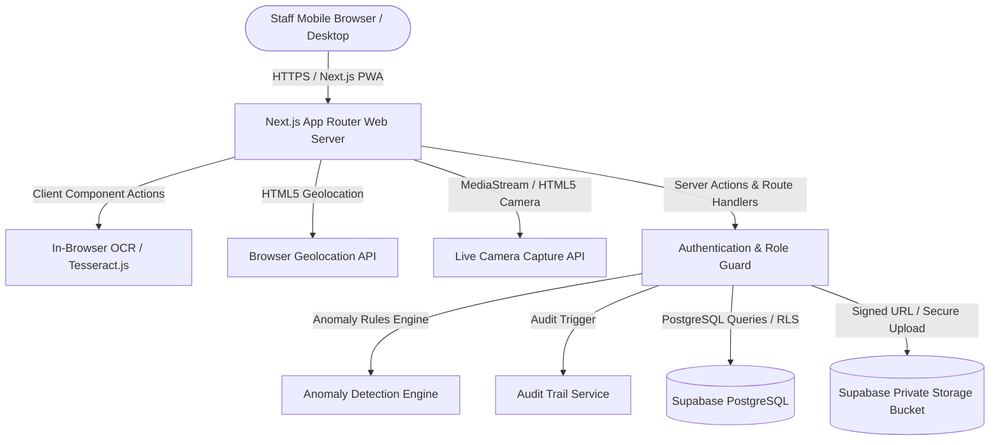

# VLMS System Architecture

## Overview
The Vehicle Log Management System (VLMS) is a mobile-first enterprise web application and Progressive Web App (PWA) designed to manage vehicle fleets, daily odometer submissions, fuel expenditures, photographic evidence, and audit tracking.

## Layers
1. **Presentation Layer (Next.js 15 App Router & React 19)**:
   - Mobile-first responsive layouts with Tailwind CSS and Lucide icons.
   - PWA support with manifest and responsive camera/location interfaces.
   - Public pages: Landing, Login, Registration, Password Reset, Help.
   - Staff Portal: Dashboard, Daily Odometer Logging, TOM Card Fuel Form, Personal Fund Fuel Form, Submissions History, Profile.
   - Management Portal: Master Dashboard with KPI cards, User Approval Queue, Vehicle Management, Fuel Transactions, Evidence Gallery, Interactive Map, Anomaly Review, CSV & Reports Export.

2. **Application & Business Logic Layer**:
   - Server-side role and active-status checks.
   - Idempotency key validation to prevent duplicate submissions.
   - Business date resolution using server-configured operating timezone (`Africa/Lagos`).
   - Odometer evidence reuse engine linking prior evidence when odometer is unchanged.
   - Odometer anomaly detection engine.

3. **Data Layer (PostgreSQL & Supabase Storage)**:
   - PostgreSQL schema with foreign keys, checks, and unique constraint on `(vehicle_id, business_date)`.
   - Row-Level Security (RLS) enforcing strict tenant and role isolation.
   - Private storage bucket (`vlms-evidence`) accessible only via short-lived signed URLs.
   - Append-only audit log table.
